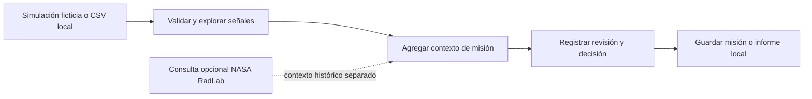

> Notas técnicas detalladas de Sentinel (comportamiento de cada función). Redactadas con asistencia de IA. El resumen para jueces está en el [README](../README.es.md).

# Salud de misión

> Prototipo web local para transformar registros de una misión espacial en una revisión clara, trazable y explicable.

## Propósito

**Salud de misión** ayuda a explorar cambios en indicadores de salud durante una misión: muestra tendencias y datos ausentes, aporta contexto de hitos, permite documentar una revisión y prepara un resumen local. Está pensado como demostración para un reto de hackatón; no sustituye la decisión humana ni una evaluación clínica.

El proyecto ofrece dos recorridos. La **simulación guiada** usa perfiles y escenarios ficticios para demostrar una revisión de principio a fin. **Trabajar con mis datos** permite importar un CSV, validar su estructura, explorar cada persona y período, añadir observaciones y conservar el proyecto en un archivo local.

## Recorrido del sistema

## Capacidades principales

- **Revisión explicable:** tendencias de pulso, sueño y reacción; línea base individual; datos faltantes visibles; hitos de misión y comparación entre días.
- **Seguimiento local:** check-ins, revisiones, decisiones, pendientes, bitácora y resumen exportable por tripulante y escenario.
- **Datos propios:** importación CSV revisable, validación de fechas, unidades, duplicados y valores ausentes; filtros por persona y período; notas e informes HTML.
- **Continuidad de trabajo:** guardar y abrir una misión completa en JSON, sin cuentas ni base de datos.
- **Contexto NASA separado:** snapshot local de CO₂ de ISS y consulta voluntaria a NASA RadLab para radiación histórica de ISS/DosTel.

## Datos, privacidad y alcance

Los escenarios de la demo son ficticios. Los datos propios se procesan en el navegador y no se envían a un servidor. La consulta NASA RadLab se inicia únicamente al pulsar su botón: transmite un rango de fechas UTC y filtros fijos de ISS/DosTel, nunca CSV, nombres, notas o mediciones importadas. Las lecturas NASA se muestran como contexto histórico independiente y no producen alertas.

El prototipo no es un dispositivo médico, no diagnostica, no predice resultados clínicos, no opera sistemas de nave y no afirma aprobación de NASA.

## Arquitectura y operación

Aplicación estática en HTML, CSS y JavaScript: funciona desde `dist/replay.html`, sin instalación, servidor, cuentas ni base de datos. Las revisiones de la demo se guardan localmente en el navegador. Las misiones importadas se conservan solo durante la sesión hasta que se descargan explícitamente como JSON. La única conexión opcional es la solicitud pública a NASA RadLab.

| Ruta | Contenido |
| --- | --- |
| `dist/replay.html` | Aplicación principal y recursos de interfaz. |
| `dist/audio.js` | Sonido ambiental y señales de la demostración. |
| `dist/assets/` | Recursos visuales locales. |
| `work/` | Pruebas de la simulación, importación, seguimiento, audio y RadLab. |

## Inicio rápido

Abrí `dist/index.html` o `dist/replay.html` en un navegador. Para el recorrido recomendado de la presentación, elegí **Ver demostración guiada · 90 s**. Para probar datos propios, elegí **Trabajar con mis datos**, descargá el CSV ficticio de ejemplo o importá uno compatible.

## Guía detallada

## Sonido de misión

La barra superior permite **Activar sonido**, silenciarlo y abrir **Volumen y ambiente**. El audio arranca apagado en cada apertura y se activa con un clic. Volumen inicial: 35 %. Se recuerdan el volumen y la elección de ambiente, cuando el almacenamiento del navegador está disponible.

Los hitos tienen tonos breves: despegue, inserción orbital, reentrada y cierre tienen motivos propios; los demás usan una señal suave. En reproducción acelerada se señala el último hito cruzado, sin encadenar todos los sonidos. Un cambio sostenido produce dos tonos de revisión, y los datos incompletos una señal distinta. Solo suenan al cambiar de estado o de perfil, con un intervalo mínimo para evitar repeticiones al explorar rápidamente. Los clics acompañan controles y selecciones; las confirmaciones de guardado suenan después de guardar correctamente revisiones, decisiones, check-ins y observaciones.

El **Ambiente de misión** acompaña el día seleccionado: cabina suave en el día 0; motores graves y vibración pulsante durante el despegue (día 1); ventilación tranquila en órbita; siseo y dos cierres de escotilla al entrar en la EVA (día 90); ráfagas de turbulencia y vibración en la reentrada (días 118–119); y cabina más silenciosa al cerrar (día 120). Son efectos narrativos sintetizados para la misión ficticia, independientes de las lecturas de salud. Al dejar un día seleccionado, el fondo continúa; los cierres de escotilla se reproducen una sola vez al entrar. Las transiciones atenúan el sonido anterior y no se reinician al redibujar la misma etapa o cambiar de tripulante. La reproducción acelerada puede saltar etapas: el fondo corresponde al día al que se llegó.

El ambiente se detiene en el menú, en datos propios, al silenciar, al poner volumen cero o al ocultar la pestaña. Los sonidos se generan localmente con Web Audio; no usan red ni archivos descargados. El botón **Probar sonido de hito** permite comprobar volumen. Las señales visuales y los controles siguen funcionando si el audio no está disponible.

Comprobación adicional: `node work/verify-audio.cjs`.

## Menú de entrada

La página abre primero un menú sobre el fondo de estación espacial. El panel de datos permanece oculto hasta entrar. Elegir tripulante, escenario y punto de inicio y pulsar **Entrar al panel de misión**. La selección inicial es A, misión nominal y día 0.

**Ver demostración guiada** abre el panel e inicia el recorrido con A. Al finalizar recupera la configuración elegida en el menú. **Menú principal**, en la cabecera del panel, pausa la reproducción y cierra cualquier recorrido activo. Desde el menú se puede cambiar la configuración o **Retomar** la vista anterior sin aplicar las nuevas selecciones.

Volver al menú no borra registros. Los borradores de revisión y opciones se conservan en memoria al cambiar de configuración y regresar al mismo tripulante, escenario y día. La opción de retomar corresponde a esta apertura de la página; al recargar vuelve a aparecer el menú inicial, mientras los registros guardados permanecen en el navegador.

El menú adapta su distribución a pantallas estrechas; el panel de datos conserva su diseño de escritorio. Queda pendiente verificar visualmente el nuevo menú, su foco y sus transiciones en un navegador real.

## Demostración guiada

Pulsar **Iniciar demostración**. El recorrido recorre seis pasos de unos 15 segundos: línea base, cambio sostenido, evidencia, datos incompletos, decisión del tripulante y resumen. Dura aproximadamente 90 segundos sin pausas ni avances manuales.

Los controles permiten pausar, continuar, retroceder, avanzar o salir. Durante el recorrido, la navegación libre de días y escenarios queda deshabilitada. La reproducción se pausa al editar una revisión, marcar una opción, abrir el resumen o cambiar a otra pestaña. Para seguir, pulsar **Continuar recorrido**.

El recorrido no escribe registros automáticamente. En el paso de decisión se pueden seleccionar opciones y guardarlas explícitamente. Al terminar, se abre el resumen del día 73 en el escenario de cambio sostenido. La vista anterior y los borradores previos se restauran al finalizar o salir; la reproducción libre queda pausada. Las anotaciones realizadas dentro del recorrido solo se conservan si se guardaron.

## Explorar y registrar

1. Explorar los días 0–120 mediante el selector o los hitos de misión.
2. Comparar los escenarios de cambio sostenido, misión nominal y datos incompletos en el día 73.
3. Consultar pulso, sueño y reacción en gráficos separados, cada uno con su unidad, eje vertical y línea base discontinua. Comparten los mismos días y mantienen escalas fijas. Las franjas y los huecos indican registros ausentes. El desplegable de valores muestra las lecturas de la ventana.
4. Guardar un check-in, una revisión o una decisión.
5. Filtrar la bitácora del escenario actual y volver al día de un registro.
6. Preparar el resumen local para ver, copiar o descargar las señales, evidencia y anotaciones guardadas del día.

Los gráficos muestran una ventana del guion con días anteriores y posteriores al seleccionado. No representan una predicción. El resumen conserva el momento en que fue preparado; después de guardar una nueva anotación hay que cerrarlo y prepararlo de nuevo. No incluye borradores.

## Eventos y comparación entre días

Los gráficos numeran los hitos que caen dentro de su ventana. Los botones sobre las curvas permiten inspeccionar despegue, ejercicio programado, EVA, reentrada y otros hitos en su día exacto. Las tres señales usan los mismos números. La tabla de lecturas también identifica los hitos. Estos eventos aportan contexto narrativo; no se añaden picos fisiológicos ni se atribuye causalidad a los cambios.

En **Comparar dos días**, elegir A como referencia y B como comparación (0–120). Se muestran las lecturas de pulso, sueño y reacción, junto con la diferencia B menos A y su porcentaje respecto de A. Se pueden intercambiar días, usar el día seleccionado en B o inspeccionar cada extremo. Los dos días pertenecen al escenario seleccionado; cambiar de escenario recalcula la comparación. Si falta una lectura, aparece **No comparable**. Las entradas inválidas ocultan los resultados hasta corregirse. Escribir en estos controles pausa la reproducción.

Durante el recorrido guiado quedan deshabilitados los nuevos controles de navegación. Los días elegidos para comparar se conservan al salir.

## Tripulación y seguimiento

Elegir una tarjeta de tripulación para cambiar entre A (comando), B (ingeniería) y C (ciencia). Son tres perfiles ficticios con líneas base y variaciones diferentes. Las gráficas, comparación entre días, evidencia, bitácora y resumen pertenecen al tripulante seleccionado. El escenario y el día de misión son comunes a los tres.

Los registros anteriores se conservan como los del tripulante A en sus claves originales. B y C usan almacenamiento separado para revisiones, decisiones, check-ins y pendientes. Cambiar de tripulante pausa la reproducción y conserva en memoria los borradores para el mismo día y escenario. Los borradores no guardados no sobreviven al cierre de la página.

**Añadir este día a pendientes** crea una revisión manual, sin duplicarla. Las solicitudes de medición guardadas en revisiones o decisiones aparecen automáticamente, agrupadas por día. Se pueden filtrar pendientes y revisados, inspeccionar su día, marcar revisado y volver a pendiente. Una nueva solicitud guardada vuelve a dejar pendiente el seguimiento de medición. Si se quita una solicitud de la decisión y ninguna revisión la conserva, ya no se muestra como solicitud activa.

Los estados se guardan localmente por tripulante y escenario. Marcar revisado no cambia las señales, no elimina alertas ni confirma una medición nueva. El resumen incluye los seguimientos del día. Los contadores de las tarjetas pertenecen al escenario seleccionado y no indican gravedad clínica.

El recorrido guiado usa al tripulante A como ejemplo y restaura la selección anterior al terminar. No crea registros ni pendientes automáticamente. Los controles de cambio de tripulante y estado de pendientes quedan bloqueados durante el recorrido.

## Datos y alcance

La aplicación no utiliza cuentas ni transmite datos de salud. El modo simulación usa datos ficticios y una referencia de CO₂ NASA EDA histórica e independiente. El modo «Trabajar con mis datos» permite importar observaciones del usuario, sin verificar su exactitud ni aplicar reglas clínicas. La consulta opcional «NASA RadLab» obtiene contexto público de radiación histórica de ISS; solo al pulsar el botón envía a NASA un rango de fechas UTC y los filtros fijos ISS/DosTel, nunca el CSV, identidades, notas ni mediciones importadas.

Los registros permanecen en el almacenamiento del navegador y en el origen donde se abrió la demo, separados por escenario. La bitácora muestra la última decisión y el último check-in guardados por día, además de todas las revisiones. Si no se pueden leer los registros, se muestra un aviso y no se reemplazan por datos vacíos.

Solicitar una medición deja constancia de la solicitud; no genera una lectura nueva. Ningún botón transmite información a Tierra. No es un dispositivo médico ni afirma aprobación de NASA.

## Comprobaciones

Ejecutar `node work/verify-demo.cjs` desde el proyecto. Incluye 53 comprobaciones de lógica: los tres escenarios en 121 días, escalas de gráficos, guardado, bitácora, resumen, errores, secuencia de 90 segundos, pausa, navegación y restauración de borradores.

Las interfaces de navegador y el reloj se simulan en las pruebas. Queda pendiente comprobar en un navegador real la apariencia, el desplazamiento y foco del recorrido, la legibilidad de ejes, la descarga y el portapapeles. El navegador integrado del chat bloqueó la apertura del archivo local.

## Trabajar con mis datos

Desde el menú, elegir **Trabajar con mis datos**. Dar un nombre a la misión, seleccionar un CSV UTF-8, revisar las columnas sugeridas y confirmar las unidades de cada señal asignada. El botón de ejemplo descarga mediciones ficticias. **Revisar datos** muestra errores sin descartar filas silenciosamente; solo un archivo válido habilita **Abrir panel con estos datos**.

- Hasta 2 MB, 5.000 registros y 40 columnas; separador coma, punto y coma o tabulación; comillas y decimales con coma admitidos. Celdas de hasta 500 caracteres.
- Fecha obligatoria: AAAA-MM-DD o instante UTC AAAA-MM-DDTHH:MM:SSZ, con milisegundos opcionales; años 1900–2200. No se mezclan fechas diarias e instantes. Duplicados por persona e instante bloquean la importación, incluso si sus zonas de precisión textual difieren.
- Persona opcional: sin esa columna, se usa el identificador indicado. Para evitar fórmulas en exportaciones, los identificadores no admiten =, +, - o @ al inicio, ni saltos de línea o tabulaciones. Hasta 80 caracteres.
- Señales: pulso (bpm), sueño (h), SpO₂ (%), temperatura (°C), masa (kg), reacción (ms). No hay conversión automática de unidades. Una columna no puede usarse dos veces.
- Vacío, NA, N/A y null significan ausencia. Se exige al menos una medición numérica por fila; los valores ausentes nunca se convierten en cero. Números sin separadores de miles; negativos solo en temperatura; SpO₂ entre 0 y 100; magnitud máxima 1.000.000 por límites de formato, sin interpretación clínica.
- Panel independiente: filtro por persona y período UTC, mínimo/máximo y tabla paginada de 50 registros. Gráficos de hasta 200 registros más recientes del período, con escalas automáticas y puntos; filtrar fechas para períodos anteriores. Los huecos corresponden a celdas ausentes, no detectan filas omitidas ni infieren una cadencia.
- **Descargar todos los datos** conserva todas las personas y fechas en CSV normalizado, incluso si hay un filtro activo. Se puede reimportar el archivo y asignar un nombre a la nueva sesión. La exportación no incluye el nombre de misión.

Los datos importados permanecen exclusivamente en memoria: volver al menú los conserva, recargar o cerrar los pierde. No se escriben automáticamente en localStorage ni se envían por red. Una importación válida reemplaza la misión propia anterior; descargarla antes si se desea conservar. La simulación y sus registros guardados están separados. No hay cuentas, servidor, colaboración entre usuarios ni evaluación clínica en esta versión.

Pruebas adicionales: `node work/verify-data.cjs`. Verifican el análisis CSV, validación, unidades, duplicados, fechas, exportación/reimportación, seguridad de texto, navegación, filtros y carga asíncrona. La apariencia y las descargas en un navegador real siguen pendientes de comprobación manual.

## Misiones completas y seguimiento

**Guardar misión completa** descarga un JSON versionado con nombre, procedencia, señales, todas las personas y mediciones, y notas añadidas. **Abrir archivo de misión** valida primero el archivo y muestra un resumen; **Abrir esta misión** reemplaza la misión actual solo al pulsarlo. Guardar una copia antes de reemplazar. Máximo 12 MB, 5.000 registros, 500 notas de hasta 2.000 caracteres. No se guardan borradores, filtros ni configuración de comparación. No hay guardado automático: los archivos deben conservarse de forma explícita. El formato de misión es `salud-de-mision`, versión 1; al leer se reconstruyen únicamente los campos admitidos y se validan señales, valores, duplicados, fechas y referencias de notas. Un archivo inválido no modifica la misión activa.

La ficha seleccionada muestra todas las observaciones añadidas de esa persona. Cada observación requiere una fecha que tenga mediciones. Los borradores se conservan al alternar entre personas durante la sesión, pero no se exportan. Añadir una observación no altera mediciones ni genera un estado clínico. Guardar una nueva copia de la misión después de añadir notas.

La comparación utiliza dos rangos inclusivos de fechas UTC, independientes del filtro principal, para la persona seleccionada. Muestra promedios aritméticos por medición disponible, conteos de valores disponibles/ausentes y diferencia B menos A. No es un promedio diario; no se interpolan valores ni se cuenta como ausente un día sin filas. Se avisa si los períodos se superponen; si faltan valores numéricos en un lado, el cambio aparece como no comparable.

**Descargar informe · HTML** genera un archivo autónomo sin scripts ni recursos externos, para abrir o imprimir desde un navegador. Incluye misión, procedencia, persona y período visible, gráficos con hasta 200 registros, tabla completa del período, observaciones añadidas en esas fechas y la comparación configurada (sus rangos se explicitan aunque estén fuera del filtro principal). Todo texto aportado por usuario se escapa antes de incluirlo en HTML. El informe no equivale a la misión editable y no incluye borradores.

Pruebas: `node work/verify-followup.cjs`, además de `verify-data.cjs` y `verify-demo.cjs`. La apariencia e impresión y los diálogos reales de archivos/descargas requieren comprobación manual en un navegador.

## NASA RadLab opcional

El panel de datos propios incluye **Radiación histórica de la ISS · NASA RadLab**. La consulta es explícita: al pulsar el botón, el navegador realiza un GET público a `https://visualization.osdr.nasa.gov/radlab/api/` con `spacecraft=ISS`, `instrument=DosTel`, un rango UTC elegido de hasta siete días y solicita `dose_equivalent_rate` en JSON. No usa clave, cookies ni credenciales (`credentials: omit`). Ningún identificador, CSV, nota, medición importada, filtro de persona ni contenido de misión forma parte de esa URL o solicitud.

La respuesta se mantiene solo en memoria y se presenta en una tabla separada como contexto histórico. Se validan hora, dosis equivalente no negativa y hasta 5.000 filas; se muestran hasta 200. La consulta se cancela a los 12 segundos y una respuesta tardía no reemplaza una consulta nueva. Si la red, CORS o la API fallan, el usuario recibe un mensaje y la misión local no cambia. Estas lecturas no se guardan en la misión, informes, CSV ni localStorage; no se mezclan con los datos aportados por usuario, no generan alertas y no representan exposición personal o evaluación de riesgo.

Pruebas: `node work/verify-radlab.cjs`. Comprueban el armado de URL, límites de fechas, análisis de respuestas de NASA con objetos o filas/columnas, deduplicación, valores inválidos, respuestas vacías, error HTTP, fallos de red, cancelación, solicitud mínima y aislamiento de la misión. La conexión real y las políticas CORS dependen del navegador y de la disponibilidad de NASA.
